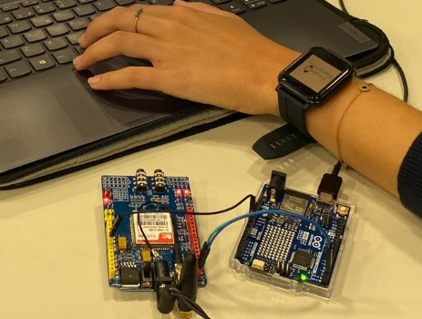
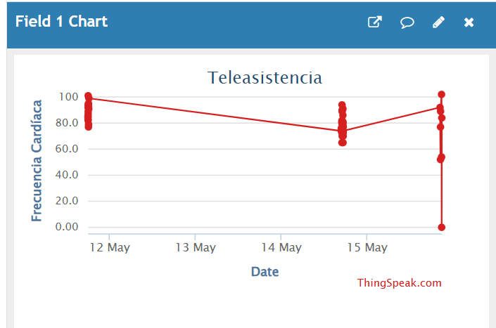
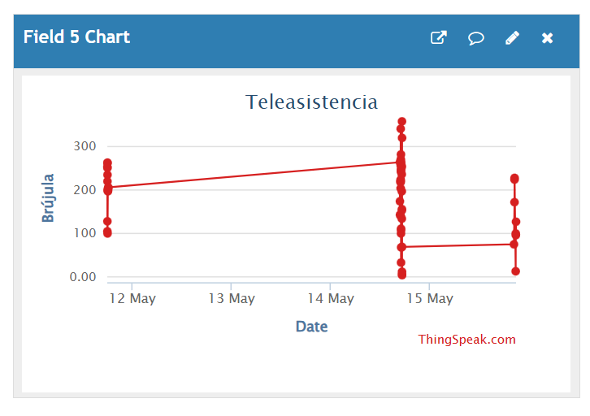

# IoT Telecare System for Real-Time Health Monitoring

**Biomedical engineering | Communications Systems | University team project (2024–2025)**

An **Internet of Things (IoT) telecare prototype** connecting a wearable smartwatch with an Arduino gateway, cloud visualization, and threshold-triggered SMS alerts. The project explores end-to-end integration of **Bluetooth Low Energy (BLE), Wi-Fi, and GSM** for remote physiological monitoring.

> **Academic proof of concept — not a medical device.** The sensor readings, alert conditions, and communications have not been clinically validated. The sanitised code below has **not** been retested on hardware.



## At a glance

| Component | Role |
| --- | --- |
| **Bangle.js smartwatch** | Collects heart rate, step count, GPS position, and compass heading |
| **Bluetooth Low Energy / GATT** | Sends JSON-formatted sensor data from smartwatch to Arduino |
| **Arduino UNO R4 WiFi** | Receives messages, parses fields, uploads telemetry, checks alert thresholds |
| **ThingSpeak via Wi-Fi** | Records measurements and displays cloud graphs |
| **SIM900 GSM module** | Sends a text-message alert when a demonstration threshold is exceeded |

## System architecture

```text
  Bangle.js smartwatch (Espruino JavaScript)
     HR · Steps · GPS · Compass
                 |
        BLE / GATT / JSON
                 v
          Arduino UNO R4 WiFi
            /           \
       Wi-Fi / HTTP      GSM serial / AT commands
          v                    v
  ThingSpeak dashboard     SIM900 SMS alert
```

## Software

- [`bangle_telecare.js`](bangle_telecare.js) — JavaScript / Espruino sensor acquisition, BLE discovery and writing a JSON payload.
- [`arduino_telecare/arduino_telecare.ino`](arduino_telecare/arduino_telecare.ino) — Arduino C++ receiving sensor data, sending HTTP requests to ThingSpeak, and issuing SIM900 AT commands.
- [`assets/`](assets/) — carefully selected photos and screenshots from the team laboratory report; the original report is intentionally excluded from this public-ready archive because it contains identifying network and location details.
- [`docs/portfolio-preview.html`](docs/portfolio-preview.html) — standalone example of how to showcase this project in a personal portfolio website.

## Implementation

1. Enable the smartwatch's heart-rate monitor, GPS and compass; count step events.
2. Discover the Arduino's advertised BLE service and connect to its writable characteristic.
3. Send a JSON payload containing `hr`, `steps`, `gps`, and `compass` from the smartwatch to the Arduino.
4. Parse received fields and upload them to ThingSpeak over Wi-Fi.
5. If the prototype rule `heart rate > 120 bpm OR steps > 8,000` is met, send an alert text via SIM900.

The supplied smartwatch script transmits approximately **every 10 seconds**. The original lab report describes **15-second** reporting, so the published timing reflects the submitted source code, not the report. Frequent uploads may need rate limiting depending on ThingSpeak plan constraints.

## Experimental evidence

The original report documents:

- BLE pairing and successful reception of sensor messages by the Arduino.
- Measurements displayed in the Arduino serial monitor.
- Data uploaded to ThingSpeak and plotted by field.
- SMS alert delivery during a laboratory test.

**ThingSpeak — heart rate**



**ThingSpeak — compass heading**



**SMS alert demonstration**


These screenshots are **test evidence**, not a claim of long-term uptime, reliable health monitoring, or clinical accuracy. The original laboratory report also contains location/network details and is **not included for public upload**.

## Tools and skills

`Arduino C++` · `JavaScript` · `Espruino` · `BLE` · `Wi-Fi` · `GSM` · `ThingSpeak` · `Embedded Systems` · `IoT` · `Biomedical Monitoring`

## Reproduction and limitations

1. Use an **Arduino UNO R4 WiFi**, **Bangle.js** watch, **SIM900 module**, valid SIM card and suitable dedicated modem power supply.
2. Open the `.ino` file in Arduino IDE. Install compatible board support and libraries (`ArduinoBLE`, `WiFiS3`, and a suitable serial implementation for the board).
3. Configure Wi-Fi, ThingSpeak API credentials and a test telephone number **locally**. The committed code contains placeholders only: never upload real credentials.
4. Load `bangle_telecare.js` via the Bangle.js / Espruino environment.
5. Verify BLE exchange, ThingSpeak updates and SMS sending on your own hardware before relying on results.

**Engineering caveats:** The original prototype uses the SIM900 on pins 0/1 with `SoftwareSerial`; serial pin/library compatibility must be checked on UNO R4 WiFi. Data is sent to ThingSpeak over **unencrypted HTTP**, and raw location measurements can be highly sensitive. The demonstration thresholds are **not physiological safety criteria**; there is no medically validated alerting logic, retry mechanism or robust alarm rate limiting. Do not deploy this design with patient data as-is.

## Publication and authorship

This was a **team university laboratory project**. The archive contains a cleaned, public-facing transcription of the supplied project materials. Specific individual contributions are not asserted here. Photos and figures have been selectively cropped/extracted; the full course PDF remains in the author's private source archive.
